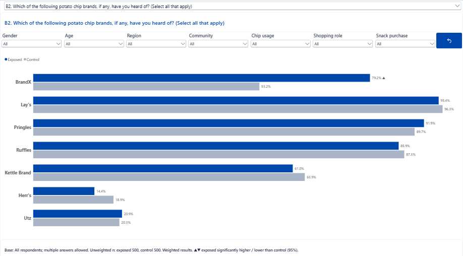

# BrandX Survey Explorer (Power BI)

An interactive Power BI explorer for survey data. Pick any question from a dropdown, see the chart that suits its type, compare exposed with control respondents, and narrow the sample to any subgroup. Every result is weighted, every base is unweighted, and significant differences are flagged on the bars.

BrandX is the worked example. The real point of this repository is the **method**: one data shape, one set of measures and one page layout that can be rebuilt for any survey by swapping the survey definition.

> **All data here is synthetic.** BrandX is a fictional potato chip brand. The study is an illustrative demonstration of research practice, not client work.

**[Open the live report](https://app.powerbi.com/view?r=eyJrIjoiYTcwZmIzOTgtOThjYS00Y2Q3LTk1NDUtMzY0ZmMxNGU5NjFkIiwidCI6IjM5MTM2YmJmLTI1ZjAtNGMxMC05ZDg0LTYzNjZiMDFmMzkyZiJ9)** | **[See it in the case study (Step 5)](https://www.moepouyan.com/brandx-step-5-analysis)** | **[Read the full six-step case study](https://www.moepouyan.com/brandx-overview)**



---

## Contents

1. [How the explorer works](#how-the-explorer-works)
2. [The data model](#the-data-model)
3. [Rebuild it for your own survey](#rebuild-it-for-your-own-survey)
4. [The critical measures](#the-critical-measures)
5. [Validation](#validation)
6. [The BrandX study](#the-brandx-study)
7. [Repository structure](#repository-structure)
8. [Open the report](#open-the-report)

---

## How the explorer works

The design rests on one idea: **store every answer as a row, store every eligible respondent as a row, and describe every question with metadata.** Once the data is in that shape, the same measures work for every question in the survey, whatever its type and whoever it was asked of.

On the **Survey Explorer** page:

- A **question dropdown** (`Questions[QuestionLabel]`, single select) picks one question.
- **Three chart visuals sit in the same space.** A visual-level filter on `Questions[QuestionType]` makes only one of them show data at a time:

  | Visual | Shows | Filter | Axis / legend |
  |---|---|---|---|
  | Clustered bar | Single and multi questions | `QuestionType` is not `Grid` | `CategoryLabel` by `StudyGroup` |
  | 100% stacked bar | Grid questions, exposed vs control | `QuestionType = Grid`, `QuestionID` is not `C5` | `ItemLabel` and `StudyGroup` by `CategoryLabel` |
  | 100% stacked bar | Grid asked of exposed only (C5) | `QuestionType = Grid`, `QuestionID = C5` | `ItemLabel` by `CategoryLabel` |

- **Seven subgroup slicers** filter the respondents: Gender, Age, Region, Community, Chip usage, Shopping role, Snack purchase.
- A **reset button** (a bookmark called *Clear subgroup filters*) clears all seven slicers at once.
- A **title card** shows the full question text, and a **base note** under the chart states who was asked, the unweighted n per group, the significance key, any active filters and a low base warning.

A second page, **QA**, holds a matrix of `Pct Exposed`, `Pct Control`, `n Exposed`, `n Control` and `Sig Arrow` by answer, used to reconcile the report against the production tables.

Nothing in the report is hardcoded to a specific question.

## The data model

Six tables: four dimensions and two fact tables. All relationships are many-to-one and single direction.

| Table | Grain | Role |
|---|---|---|
| `Respondents` | One row per respondent | Study group, weight, and every subgroup field (each with an `_Order` column for sorting) |
| `Questions` | One row per question | Label, section, type (`Single`, `Multi`, `Grid`), base description, exposed-only flag |
| `Items` | One row per grid row | Grid statements, channels or brands. Single and multi questions get one placeholder item, `(none)` |
| `Categories` | One row per answer option | Label, order within the question, bar colour, global sort key |
| `Answers` | Respondent x question x item x answer | **Numerator.** Multi questions have one row per option selected |
| `Bases` | Respondent x question x item | **Denominator.** One row per respondent who was asked that question (or grid row) |

```
Answers[RespondentID] -> Respondents[RespondentID]     Bases[RespondentID] -> Respondents[RespondentID]
Answers[QuestionID]   -> Questions[QuestionID]          Bases[QuestionID]   -> Questions[QuestionID]
Answers[ItemKey]      -> Items[ItemKey]                 Bases[ItemKey]      -> Items[ItemKey]
Answers[CategoryKey]  -> Categories[CategoryKey]
```

Two rules make the model work:

1. **`Categories` filters `Answers` only, never `Bases`.** Each answer is divided by the full base for the question, so multi-response percentages can add to more than 100% and single-response percentages add to 100%.
2. **`Items` and `Categories` are not related to `Questions`.** The question filter reaches them through the fact tables. A direct link would create ambiguous filter paths.

**Why a separate `Bases` table?** Because the base is not the same as "people who answered". B2.a is asked only of people aware of each brand, so its base differs by brand. C2 is asked only of exposed respondents who recall the ad. Section C is exposed only. Writing eligibility into `Bases` at build time means the measures never need to know these rules.

Column-level detail is in [`docs/data-model.md`](docs/data-model.md).

## Rebuild it for your own survey

### Step 1. Describe your survey in `scripts/survey_definition.py`

This is the only survey-specific file. It has four parts:

- `load(path)`: read your data file and add any derived variables (BrandX bands the 1 to 10 impression scores into 1-6, 7-8 and 9-10)
- `respondents(df, vl)`: map your group variable, weight variable and subgroup fields, each with a sort order column
- `questions(vl)`: list each question with its type, its variable or items, its answer codes and labels, and who it was asked of:

```python
dict(id='C2', sec='C', type='single', exposed=True, basevar=('C1', 1),
     title='C2. Where did you see or hear the advertisement? (Select one)',
     base='Exposed respondents who recall BrandX advertising (C1 = Yes)', var='C2',
     cats=[(1, 'Television'), (2, 'Radio'), ...])
```

| Type | Data it expects | Becomes |
|---|---|---|
| `single` | One coded variable (`var`) and answer codes (`cats`) | One answer row per respondent |
| `multi` | One 0/1 dummy column per option (`items`) | One answer row per option selected |
| `grid` | One coded column per row (`items`) sharing one scale (`cats`) | One answer row per respondent per grid row |

Eligibility flags: `exposed=True` (test group only), `basevar=('C1', 1)` (asked only where C1 = 1), `rowbase=True` (base differs by grid row).

- `CHECKS`: a few results you already know from your production tables, used for validation

### Step 2. Build the six tables

```bash
pip install -r requirements.txt
cd scripts
python build_model.py ../data/source/BrandX_Aug2026.sav ../data/model
```

`build_model.py` is survey-agnostic. It writes the six model tables plus `Validation.csv` with the expected weighted % and unweighted base for each check, computed exactly the way the DAX measures will compute them.

It also builds `Categories[CategorySort]`. Power BI's *Sort by column* needs exactly one sort value per label, but the same label (for example "Not sure") appears in several questions in different positions. The script merges the per-question orders into one consistent ranking, so every chart keeps its scale order.

### Step 3. Load and relate the tables in Power BI

1. **Get data** and load the six CSVs from `data/model`.
2. Create the seven relationships listed above, all **many-to-one, single direction**.
3. Set **Sort by column**: `CategoryLabel` by `CategorySort`, `ItemLabel` by `ItemOrder`, `QuestionLabel` by `QuestionOrder`, `StudyGroup` by `StudyGroupOrder`, and each subgroup field by its `_Order` column.
4. Create an empty table called `_Measures` to hold the measures.
5. Apply the theme `report/BrandX_PowerBI_Theme.json` (View > Themes > Browse for themes).

### Step 4. Add the measures

Paste the measures from [`dax/measures.dax`](dax/measures.dax) into `_Measures`. They reference only the generic model, so they work unchanged for any survey built in Step 2. Edit `Filter Note` if your subgroup fields differ, and the question list in `Sort Key` if you want different questions sorted by value.

### Step 5. Build the Survey Explorer page

1. **Question slicer:** `Questions[QuestionLabel]`, dropdown, single select.
2. **Title card:** card visual with `[Question Title]`.
3. **Subgroup slicers:** one dropdown slicer per subgroup field in `Respondents`.
4. **Chart for single and multi questions:** clustered bar chart.
   - Y axis `Categories[CategoryLabel]`, X axis `[Weighted %]`, legend `Respondents[StudyGroup]`
   - Data labels from `[Bar Label]` (value plus ▲ or ▼)
   - Add `[Sort Key]` to tooltips and sort the axis by it, ascending
   - Visual filter: `Questions[QuestionType]` is not `Grid`
5. **Chart for grid questions:** 100% stacked bar chart.
   - Y axis `Items[ItemLabel]` then `Respondents[StudyGroup]`, legend `Categories[CategoryLabel]`, X axis `[Weighted %]`
   - Data labels from `[Grid Label]`, tooltips `[Unweighted Base]` and `[Sig Arrow]`
   - Visual filter: `QuestionType = Grid`
6. **Exposed-only grid:** copy of the grid chart without `StudyGroup` on the axis, filtered to those questions (here `C5`). Exclude them from the first grid chart.
7. **Stack the three charts** in the same position. Only the one that matches the selected question's type returns data.
8. **Base note:** card visual with `[Base Note]` under the charts.
9. **Reset button:** clear all subgroup slicers, add a bookmark that captures only those slicers (Data on, Display and Current page off), and add a button with a Bookmark action pointing to it.

### Step 6. Validate

Build a QA page with a matrix of `Categories[CategoryLabel]` by `[Pct Exposed]`, `[Pct Control]`, `[n Exposed]`, `[n Control]` and `[Sig Arrow]`. Check it against `Validation.csv` and your production tables. See [Validation](#validation).

## The critical measures

The full set of 17 measures is in [`dax/measures.dax`](dax/measures.dax). These are the ones that matter.

### Weighted count and weighted base

```dax
Weighted Count =
SUMX ( Answers, RELATED ( Respondents[Weight] ) )

Weighted Base =
CALCULATE (
    SUMX ( Bases, RELATED ( Respondents[Weight] ) ),
    KEEPFILTERS ( TREATAS ( VALUES ( Categories[QuestionID] ), Questions[QuestionID] ) )
)

Weighted % =
DIVIDE ( [Weighted Count], [Weighted Base] )
```

The numerator comes from `Answers`, the denominator from `Bases`, and the weight sits once on the respondent. Because `Categories` does not filter `Bases`, the base stays the same for every answer option.

The `TREATAS` line makes the base follow the question of the answer options on the axis. Without it, a visual with `CategoryLabel` on the axis but no question filter in context would divide by the base of every question at once.

### Unweighted base

```dax
Unweighted Base =
CALCULATE (
    COUNTROWS ( Bases ),
    KEEPFILTERS ( TREATAS ( VALUES ( Categories[QuestionID] ), Questions[QuestionID] ) )
)
```

Reporting convention: **weighted percentages, unweighted bases**, matching the SPSS CTABLES output.

### Exposed vs control

```dax
Pct Exposed =
CALCULATE (
    [Weighted %],
    REMOVEFILTERS ( Respondents[StudyGroupOrder] ),
    Respondents[StudyGroup] = "Exposed"
)
```

`Pct Control`, `n Exposed` and `n Control` follow the same pattern. `REMOVEFILTERS` on the sort column is needed because `StudyGroup` is sorted by `StudyGroupOrder`, and Power BI filters both columns together.

### Significance testing

```dax
Sig Exposed vs Control =
VAR n1 = [n Exposed]
VAR n2 = [n Control]
VAR p1 = COALESCE ( [Pct Exposed], 0 )
VAR p2 = COALESCE ( [Pct Control], 0 )
VAR valid =
    HASONEVALUE ( Categories[CategoryLabel] )
        && NOT ISBLANK ( n1 ) && NOT ISBLANK ( n2 )
        && n1 >= 50 && n2 >= 50
        && p1 <= 1 && p2 <= 1
VAR p =
    IF ( valid, DIVIDE ( p1 * n1 + p2 * n2, n1 + n2 ) )
RETURN
    IF (
        valid && p > 0 && p < 1,
        VAR se = SQRT ( p * ( 1 - p ) * ( 1 / n1 + 1 / n2 ) )
        VAR z = ( p1 - p2 ) / se
        RETURN IF ( z >= 1.96, 1, IF ( z <= -1.96, -1, 0 ) )
    )

Sig Arrow =
IF (
    ISBLANK ( [Weighted %] ) || SELECTEDVALUE ( Respondents[StudyGroup] ) = "Control",
    BLANK (),
    SWITCH ( [Sig Exposed vs Control], 1, "▲", -1, "▼", "" )
)
```

A two-proportion z-test at 95% using weighted percentages and unweighted bases. It is not run when either group has fewer than 50 respondents. The arrow appears on the exposed bar only.

### Base note and filter note

`Base Note` builds the sentence under the chart from `Questions[BaseDescription]`, the unweighted n per group, the significance key, `Filter Note` (which lists any active subgroup slicers) and a caution when a base falls below 50. Readers always know who they are looking at.

### Sort Key

Scales keep their natural order (`CategorySort`). Nominal lists (C2, C6, C7) sort by the exposed percentage, with "Other" and "don't know" options pinned to the bottom.

## Validation

Before publishing, confirm for at least one question of each type:

- [ ] Unweighted bases match the production tables
- [ ] Weighted percentages match to one decimal place
- [ ] Multi-response percentages use respondents, not mentions, as the base
- [ ] Filtered questions (B2.a, C2, Section C) show the correct reduced base
- [ ] Subgroup slicers reproduce the banner columns of the production tables
- [ ] Significance arrows agree with the production significance tests

For BrandX, `data/model/Validation.csv` holds 18 checks. For example:

| Check | Exposed | Control |
|---|---|---|
| Aided awareness: BrandX (B2) | 79.2% (n=500) | 53.2% (n=500) |
| Unaided recall: BrandX (B1) | 30.3% | 16.1% |
| Promoters 9-10 (B5) | 34.8% | 17.8% |
| BrandX impression 9-10, among aware (B2.a) | 37.6% (n=393) | 25.2% (n=267) |
| Ad seen on TV, among ad recallers (C2) | 52.7% (n=318) | not asked |

## The BrandX study

BrandX ran a TV campaign on Channels A and B and needed to know whether it worked. The study uses an exposed vs control design: viewers of Channel A or B form the exposed group, and people who watched neither form the control group.

| Section | Questions | Compared |
|---|---|---|
| A: Screening | A5 channel viewing | Exposed vs control |
| B: Brand metrics | B1 unaided recall, B2 aided awareness, B2.a impression, B3 familiarity, B4 consideration, B5 recommendation | Exposed vs control |
| C: Advertisement | C1 ad recall, C2 where seen, C3 recognition, C4 enjoyment, C5 ad statements, C6 main message (coded open end), C7 main message | Exposed only |

- **Sample:** 1,000 valid completes, 500 exposed and 500 control
- **Weighting:** rim weighting (raking) by age, gender and province (`Weight_Final2`)
- **Production tables:** SPSS CTABLES; this report reproduces them
- **Questionnaire:** [full questionnaire documentation](https://www.moepouyan.com/questionnaire-example-brandx)

## Repository structure

```
brandx-survey-explorer/
├── report/
│   ├── BrandX Survey Explorer.pbix     Power BI report
│   └── BrandX_PowerBI_Theme.json       Report theme
├── dax/
│   └── measures.dax                    All 17 measures
├── scripts/
│   ├── survey_definition.py            Survey-specific setup (edit this)
│   └── build_model.py                  Builds the six tables (reusable as is)
├── data/
│   ├── source/
│   │   ├── BrandX_Aug2026.sav          Synthetic respondent-level SPSS file
│   │   └── BrandX_Codebook.xlsx        Variable and value labels
│   └── model/                          The six model tables plus Validation.csv
├── docs/
│   └── data-model.md                   Column-level reference
├── images/
├── requirements.txt
└── LICENSE
```

## Open the report

1. Install [Power BI Desktop](https://www.microsoft.com/power-bi/desktop) (Windows).
2. Clone or download this repository.
3. Open `report/BrandX Survey Explorer.pbix`. The data is already loaded, so the report works straight away.
4. To refresh from your own copy, go to **Transform data > Data source settings** and point the source to your file. The original report loads the six tables from an Excel workbook with one sheet per table; loading the CSVs in `data/model` works the same way.

## Author

**Moe Pouyan**, research, insights and customer experience. Toronto, Ontario.
[moepouyan.com](https://www.moepouyan.com)

## License

- Code (`scripts/`, `dax/`): [MIT](LICENSE)
- Synthetic data (`data/`) and the report: [CC BY 4.0](data/LICENSE)
